# 基于web的铁路订票管理系统--论文

> 🎓 **计算机毕业设计 · 基于web的铁路订票管理系统--论文**
>
> 本仓库只放**项目介绍 + 运行截图**（截图是站点带水印的原图，存在仓库 `images/` 里）。
>
> 👉 **完整可运行源码 / 数据库脚本 / 部署文档：[点我获取](https://geekcode.top/archives/%E5%9F%BA%E4%BA%8Eweb%E7%9A%84%E9%93%81%E8%B7%AF%E8%AE%A2%E7%A5%A8%E7%AE%A1%E7%90%86%E7%B3%BB%E7%BB%9F-%E8%AE%BA%E6%96%87?utm_source=github)**
>
> 💬 咨询微信：**ir9372**　|　🌐 更多项目：[极客代码 geekcode.top](https://geekcode.top/?utm_source=github)
>
> 📌 项目详情页：<https://geekcode.top/archives/%E5%9F%BA%E4%BA%8Eweb%E7%9A%84%E9%93%81%E8%B7%AF%E8%AE%A2%E7%A5%A8%E7%AE%A1%E7%90%86%E7%B3%BB%E7%BB%9F-%E8%AE%BA%E6%96%87?utm_source=github>

<table><td width="230" align="center"> <b>扫码加微信 ir9372</b></td><td valign="middle">📦 源码 = 项目介绍 + 全部运行截图 + 数据库 + 部署文档 👉 点上方任意截图，直接跳到 <b>极客代码 geekcode.top</b> 详情页</td></table>

---

<h1>基于web的铁路订票管理系统--论文</h1>
<h2>项目概述</h2>

本项目为基于 Web 的铁路订票管理系统，旨在通过数字化手段优化铁路票务服务流程。系统采用前后端分离架构，核心功能涵盖火车信息管理、车票预订、退票处理及公告资讯发布。前台面向普通用户，提供首页浏览、火车信息查询及公告阅读；后台面向管理员，实现对各业务模块的全面管控。适用人群包括需要查询和购买火车票的旅客以及负责运营维护的系统管理员。技术架构上，后端基于 Spring Boot 框架，集成 MyBatis-Plus 进行数据持久化，使用 Shiro 保障安全认证，前端结合 Vue 技术栈，构建高效、稳定的在线订票服务平台。

<h2>技术架构</h2>
<h3>1. 总体架构设计</h3>

系统采用经典的分层架构模式，分为表现层、业务逻辑层、数据访问层和数据库层。

<ul>
<li><strong>表现层</strong>：由 Vue.js 构建的前端界面组成，分为用户前台和管理员后台两部分，通过 HTTP 请求与后端交互。</li>
<li><strong>业务逻辑层</strong>：基于 Spring Boot 框架开发，包含多个 Controller 控制器（如 <code>HuocheleixingController</code>, <code>ChepiaoyudingController</code> 等），负责处理具体的业务逻辑、参数校验及服务调用。</li>
<li><strong>数据访问层</strong>：使用 MyBatis-Plus 作为 ORM 框架，简化了 SQL 编写与数据库操作，支持通用的 CRUD 方法及复杂查询。</li>
<li><strong>安全控制层</strong>：集成 Apache Shiro 框架，负责系统的身份认证、授权管理及会话控制，确保只有合法用户才能访问特定资源。</li>
</ul>
<h3>2. 核心技术选型理由</h3>
<ul>
<li><strong>Spring Boot</strong>：提供快速开发能力，自动配置机制减少了繁琐的 XML 配置，内置 Tomcat 容器便于部署，适合构建微服务或单体应用。</li>
<li><strong>MyBatis-Plus</strong>：在 MyBatis 基础上增强，提供了更便捷的通用 Mapper 和服务层接口，提高了开发效率，同时保持了对 SQL 的控制力。</li>
<li><strong>Shiro</strong>：轻量级且强大的安全框架，易于集成，能够灵活处理权限验证，适合中小型 Web 应用的安全需求。</li>
<li><strong>MySQL</strong>：关系型数据库，稳定可靠，广泛支持各种数据类型和事务处理，适合作为票务系统的数据存储引擎。</li>
</ul>
<h3>3. 数据库设计要点</h3>

根据代码上下文中的实体类和控制器的命名，数据库主要包含以下核心表结构：

<ul>
<li><strong>用户表 (<code>yonghu</code>)</strong>：存储注册用户的基本信息，用于登录认证及个人中心展示。</li>
<li><strong>火车信息表 (<code>huochexinxi</code>)</strong>：记录车次、出发地、目的地、时间等基础数据。</li>
<li><strong>火车类型表 (<code>huocheleixing</code>)</strong>：对列车进行分类管理（如高铁、动车等）。</li>
<li><strong>车票预订表 (<code>chepiaoyuding</code>)</strong>：关联用户与火车信息，记录订单状态、座位号及价格。</li>
<li><strong>车票退票表 (<code>chepiaotuipiao</code>)</strong>：记录用户的退票申请及处理结果。</li>
<li><strong>公告资讯表 (<code>news</code>)</strong>：存储系统发布的新闻或通知。</li>
<li><strong>评论表 (<code>discusshuochexinxi</code>)</strong>：用户对火车信息的反馈与评价。</li>
<li><strong>收藏表 (<code>storeup</code>)</strong>：记录用户收藏的火车信息或文章。</li>
<li><strong>配置表 (<code>config</code>)</strong>：存储系统全局配置参数。</li>
</ul>
<h2>功能模块</h2>
<h3>1. 前台用户端功能</h3>

前台界面简洁直观，主要服务于普通旅客的信息获取与交互需求。

<ul>
<li><strong>首页</strong>：展示系统欢迎语、最新公告摘要及快捷入口。</li>
<li><strong>火车信息列表</strong>：用户可以浏览所有可用的火车班次，查看详细信息（如车次、时间、类型），并支持按条件筛选。</li>
<li><strong>火车类型列表</strong>：展示不同类别的列车（如 G字头、D字头等），帮助用户快速定位所需车型。</li>
<li><strong>公告资讯</strong>：显示系统发布的新闻、通知或服务指南，支持查看详情。</li>
<li><strong>个人中心</strong>：</li>
<li><strong>车票预订列表</strong>：查看当前用户发起的车票预订记录及状态。</li>
<li><strong>车票退票列表</strong>：查看历史退票申请记录及处理进度。</li>
<li><strong>收藏列表</strong>：管理用户收藏的火车信息或资讯内容。</li>
</ul>
<h3>2. 后台管理端功能</h3>

后台供管理员使用，具备完整的数据增删改查及业务审核能力。

<ul>
<li><strong>登录页</strong>：管理员输入账号密码进行身份验证。</li>
<li><strong>首页仪表盘</strong>：展示系统运行概况或快捷导航。</li>
<li><strong>系统简介 (<code>systemintro</code>)</strong>：编辑和管理关于本系统的介绍文本。</li>
<li><strong>关于我们 (<code>aboutus</code>)</strong>：维护公司或平台的背景介绍页面内容。</li>
<li><strong>公告资讯 (<code>news</code>)</strong>：发布、编辑、删除及审核前台展示的新闻公告。</li>
<li><strong>火车类型 (<code>huocheleixing</code>)</strong>：管理列车的分类字典，支持新增或删除类型。</li>
<li><strong>火车信息 (<code>huochexinxi</code>)</strong>：录入和维护具体的车次数据，包括时刻表、票价等核心信息。</li>
<li><strong>车票预订 (<code>chepiaoyuding</code>)</strong>：查看所有用户的订票记录，支持手动修改订单状态或取消异常订单。</li>
<li><strong>车票退票 (<code>chepiaotuipiao</code>)</strong>：审核和处理用户的退票申请，确认退款状态。</li>
<li><strong>用户管理 (<code>yonghu</code>)</strong>：查看注册用户的列表，支持重置密码、禁用账户等操作。</li>
<li><strong>火车信息评论 (<code>discusshuochexinxi</code>)</strong>：审核用户提交的评论内容，删除违规信息。</li>
<li><strong>系统配置 (<code>config</code>)</strong>：设置系统的全局参数，如网站标题、联系方式等。</li>
</ul>
<h2>用户角色与权限</h2>

系统主要划分为两种角色，各自拥有不同的操作权限：

<h3>1. 普通用户 (User)</h3>
<ul>
<li><strong>权限范围</strong>：仅限前台访问及部分个人数据管理。</li>
<li><strong>具体功能</strong>：</li>
<li>浏览首页、火车信息、火车类型及公告资讯。</li>
<li>在个人中心查看自己的“车票预订”、“车票退票”及“收藏”记录。</li>
<li>提交评论（依据代码中存在的 <code>DiscusshuochexinxiController</code> 推断，虽截图未直接显示评论入口，但后台有评论管理，通常前台具备提交功能）。</li>
<li><strong>限制</strong>：无法访问后台管理界面，无法修改他人数据，无法执行系统配置操作。</li>
</ul>
<h3>2. 管理员 (Admin)</h3>
<ul>
<li><strong>权限范围</strong>：拥有后台全部管理权限及前台内容的最终控制权。</li>
<li><strong>具体功能</strong>：</li>
<li>登录后台管理系统。</li>
<li>对所有业务数据（火车信息、类型、预订、退票、用户、公告、评论）执行完整的 CRUD（创建、读取、更新、删除）操作。</li>
<li>审核退票申请和处理订单异常。</li>
<li>管理用户账户状态。</li>
<li>配置系统全局参数及静态页面内容（如“关于我们”、“系统简介”）。</li>
</ul>
<h2>项目特色与创新点</h2>
<ol>
<li><strong>闭环的业务流程</strong>：系统不仅实现了基础的“查询-预订”功能，还完善了“退票”处理流程以及“评论”互动机制，形成了从购票到售后服务的完整业务闭环，提升了用户体验的真实感。</li>
<li><strong>细粒度的数据管理</strong>：将“火车类型”独立建模，使得列车分类更加清晰，便于前端进行多维度的筛选和展示；同时引入“收藏”功能，增强了用户粘性和个性化服务能力。</li>
<li><strong>标准化的后台运维体系</strong>：后台涵盖了从内容发布（公告）、基础数据维护（火车信息/类型）到交易处理（预订/退票）的全方位管理模块，并配备了“系统配置”和“简介/关于”页面的动态管理能力，降低了后期运营维护的技术门槛。</li>
<li><strong>安全可靠的架构支撑</strong>：采用 Shiro 进行权限控制和认证，确保了用户数据和系统管理接口的安全性；MyBatis-Plus 的使用保证了数据操作的规范性和高效性。</li>
</ol>
<h2>部署环境</h2>

为了确保系统正常运行，需准备以下软硬件环境：

<h3>1. 硬件环境</h3>
<ul>
<li>CPU：建议 Intel Core i5 及以上处理器。</li>
<li>内存：建议 8GB 及以上 RAM。</li>
<li>硬盘：建议预留 20GB 以上可用空间用于存储代码、日志及数据库文件。</li>
</ul>
<h3>2. 软件环境</h3>
<ul>
<li><strong>操作系统</strong>：Windows 10/11, Linux (CentOS 7+, Ubuntu 18.04+) 或 macOS。</li>
<li><strong>JDK</strong>：Java Development Kit 1.8 或更高版本（推荐 JDK 1.8 LTS，以兼容 Spring Boot 常见版本）。</li>
<li><strong>数据库</strong>：MySQL 5.7 或 MySQL 8.0+。需安装相应的 JDBC 驱动（项目中已依赖 <code>mysql-connector-java</code>）。</li>
<li><strong>Web 服务器</strong>：内置于 Spring Boot 的 Tomcat，无需单独安装外部 Tomcat，也可选择部署到独立的 Nginx/Apache 反向代理后。</li>
<li><strong>Node.js</strong>：如果前端工程需要本地编译打包，建议安装 Node.js v14 或 v16 版本，配合 npm/yarn/pnpm 包管理器。</li>
<li><strong>浏览器</strong>：Chrome, Firefox, Edge 等现代主流浏览器，以确保前端 Vue 界面的正常渲染。</li>
</ul>
<h3>3. 开发工具（可选）</h3>
<ul>
<li>IDE：IntelliJ IDEA 或 Eclipse（用于后端 Java 代码开发与调试）。</li>
<li>编辑器：VS Code（用于前端 Vue 代码编辑）。</li>
<li>数据库管理工具：Navicat for MySQL 或 DBeaver。</li>
</ul>
<h2>五、技术特性</h2>
<ul>
<li>前后端集成部署，前端资源打包至后端 static 目录</li>
<li>使用 MyBatis-Plus 简化数据访问层开发</li>
<li>集成 Shiro 权限框架实现角色权限控制</li>
</ul>
<h2>六、功能模块截图</h2>
<h3>前台用户端</h3>
<h4>前台-车票退票列表</h4>

<h4>前台-车票预订列表</h4>

<a href="https://geekcode.top/archives/%E5%9F%BA%E4%BA%8Eweb%E7%9A%84%E9%93%81%E8%B7%AF%E8%AE%A2%E7%A5%A8%E7%AE%A1%E7%90%86%E7%B3%BB%E7%BB%9F-%E8%AE%BA%E6%96%87?utm_source=github" title="查看完整源码">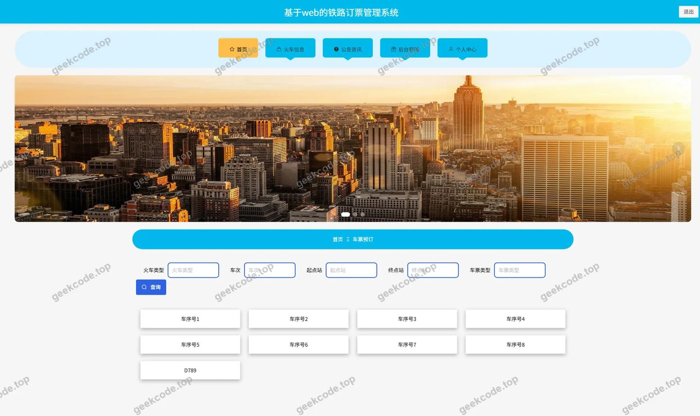</a>

<h4>前台-火车类型列表</h4>

<a href="https://geekcode.top/archives/%E5%9F%BA%E4%BA%8Eweb%E7%9A%84%E9%93%81%E8%B7%AF%E8%AE%A2%E7%A5%A8%E7%AE%A1%E7%90%86%E7%B3%BB%E7%BB%9F-%E8%AE%BA%E6%96%87?utm_source=github" title="查看完整源码">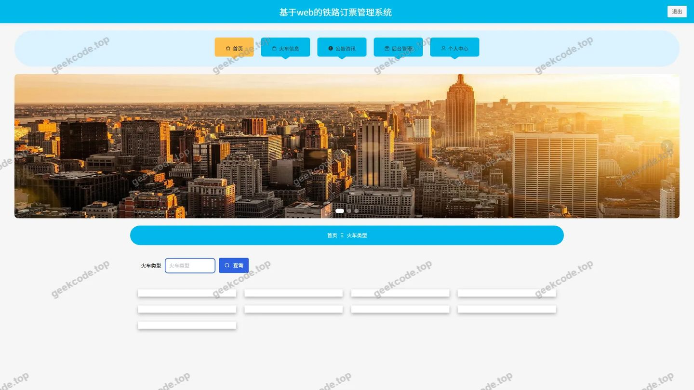</a>

<h4>前台-火车信息列表</h4>

<a href="https://geekcode.top/archives/%E5%9F%BA%E4%BA%8Eweb%E7%9A%84%E9%93%81%E8%B7%AF%E8%AE%A2%E7%A5%A8%E7%AE%A1%E7%90%86%E7%B3%BB%E7%BB%9F-%E8%AE%BA%E6%96%87?utm_source=github" title="查看完整源码">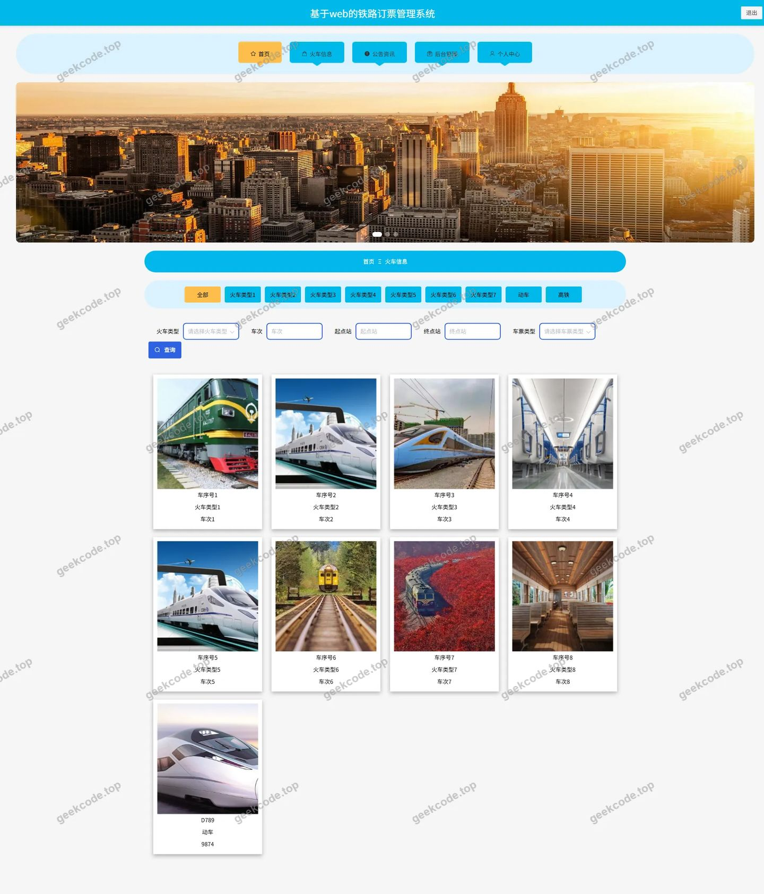</a>

<h4>前台-收藏列表</h4>

<a href="https://geekcode.top/archives/%E5%9F%BA%E4%BA%8Eweb%E7%9A%84%E9%93%81%E8%B7%AF%E8%AE%A2%E7%A5%A8%E7%AE%A1%E7%90%86%E7%B3%BB%E7%BB%9F-%E8%AE%BA%E6%96%87?utm_source=github" title="查看完整源码">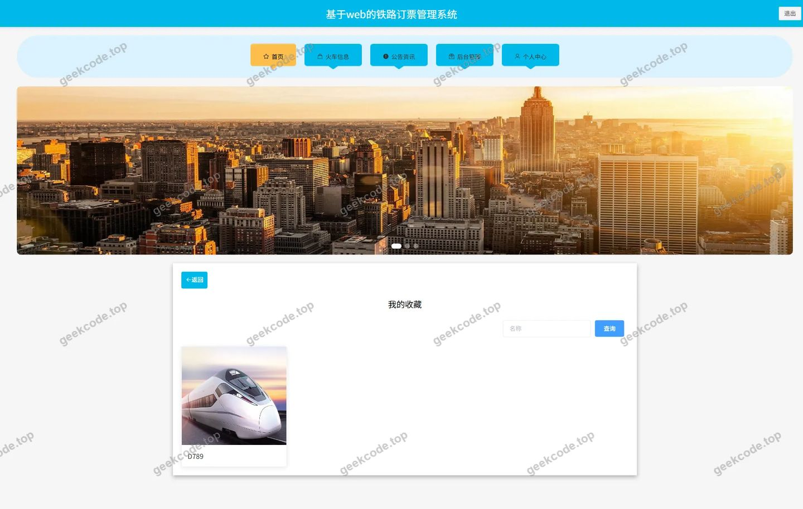</a>

<h4>前台-个人中心</h4>

<a href="https://geekcode.top/archives/%E5%9F%BA%E4%BA%8Eweb%E7%9A%84%E9%93%81%E8%B7%AF%E8%AE%A2%E7%A5%A8%E7%AE%A1%E7%90%86%E7%B3%BB%E7%BB%9F-%E8%AE%BA%E6%96%87?utm_source=github" title="查看完整源码">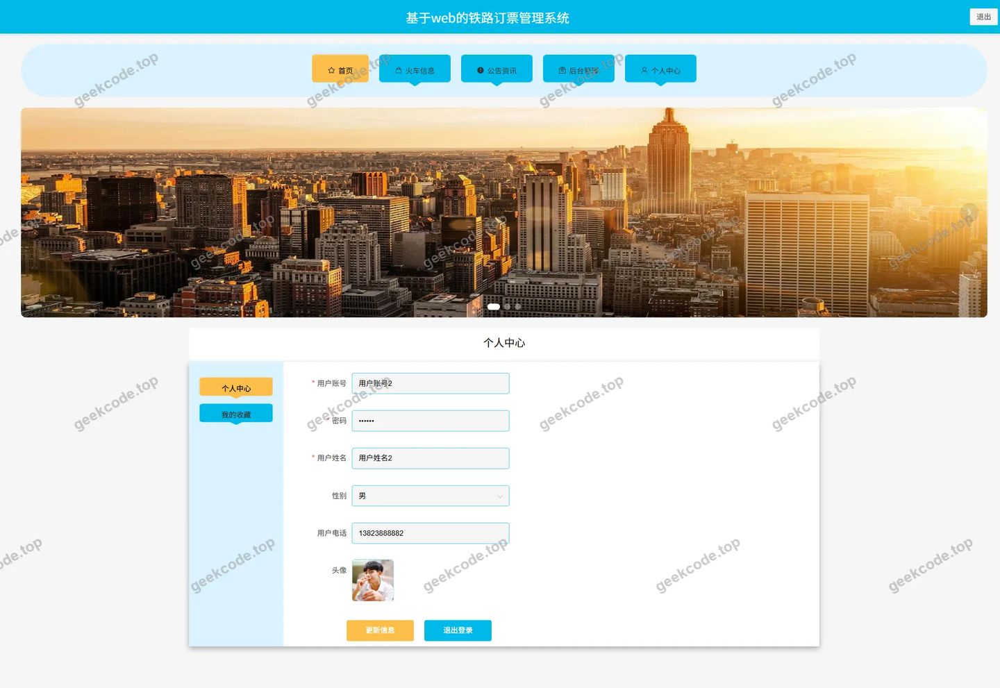</a>

<h4>前台-公告列表</h4>

<a href="https://geekcode.top/archives/%E5%9F%BA%E4%BA%8Eweb%E7%9A%84%E9%93%81%E8%B7%AF%E8%AE%A2%E7%A5%A8%E7%AE%A1%E7%90%86%E7%B3%BB%E7%BB%9F-%E8%AE%BA%E6%96%87?utm_source=github" title="查看完整源码">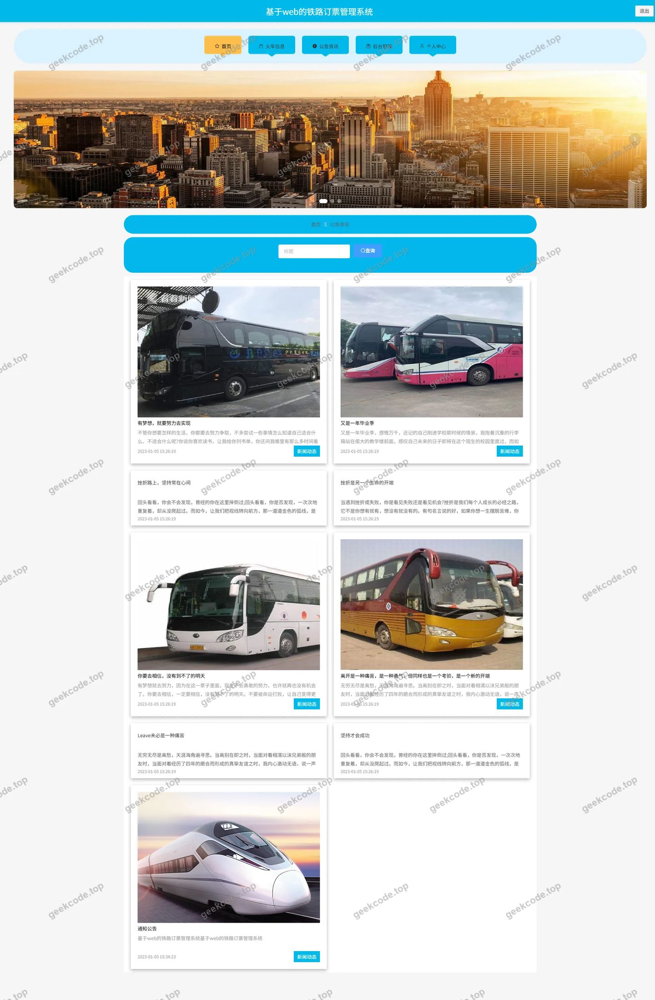</a>

<h3>后台管理端</h3>
<h4>后台-车票退票</h4>

<a href="https://geekcode.top/archives/%E5%9F%BA%E4%BA%8Eweb%E7%9A%84%E9%93%81%E8%B7%AF%E8%AE%A2%E7%A5%A8%E7%AE%A1%E7%90%86%E7%B3%BB%E7%BB%9F-%E8%AE%BA%E6%96%87?utm_source=github" title="查看完整源码">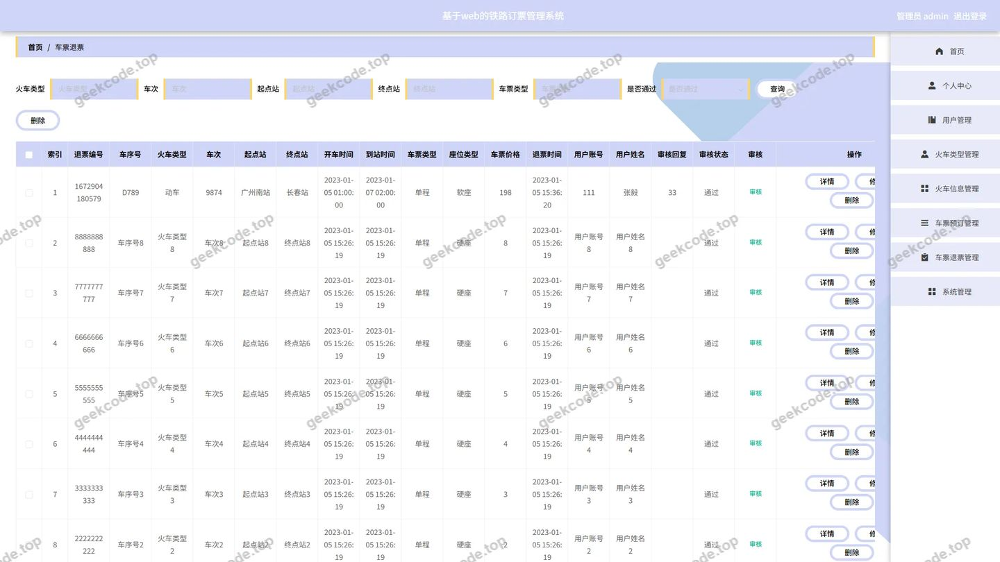</a>

<h4>后台-车票预订</h4>

<a href="https://geekcode.top/archives/%E5%9F%BA%E4%BA%8Eweb%E7%9A%84%E9%93%81%E8%B7%AF%E8%AE%A2%E7%A5%A8%E7%AE%A1%E7%90%86%E7%B3%BB%E7%BB%9F-%E8%AE%BA%E6%96%87?utm_source=github" title="查看完整源码">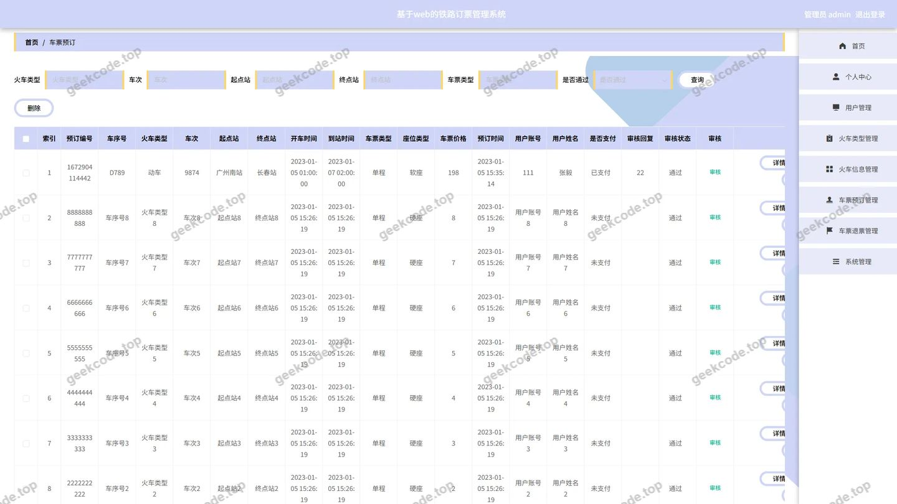</a>

<h4>后台-登录页</h4>

<a href="https://geekcode.top/archives/%E5%9F%BA%E4%BA%8Eweb%E7%9A%84%E9%93%81%E8%B7%AF%E8%AE%A2%E7%A5%A8%E7%AE%A1%E7%90%86%E7%B3%BB%E7%BB%9F-%E8%AE%BA%E6%96%87?utm_source=github" title="查看完整源码">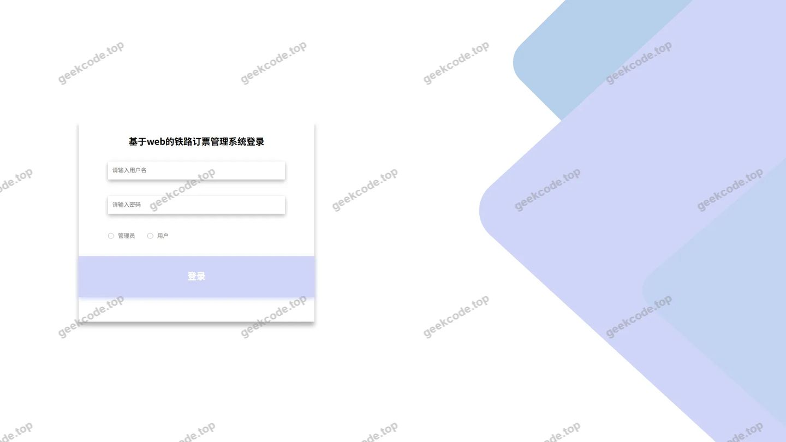</a>

<h4>后台-公告资讯</h4>

<a href="https://geekcode.top/archives/%E5%9F%BA%E4%BA%8Eweb%E7%9A%84%E9%93%81%E8%B7%AF%E8%AE%A2%E7%A5%A8%E7%AE%A1%E7%90%86%E7%B3%BB%E7%BB%9F-%E8%AE%BA%E6%96%87?utm_source=github" title="查看完整源码">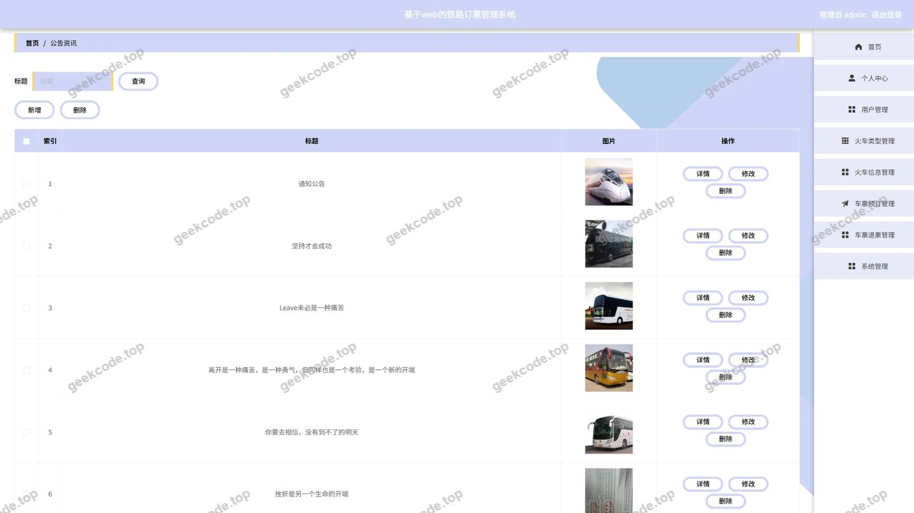</a>

<h4>后台-关于我们</h4>

<a href="https://geekcode.top/archives/%E5%9F%BA%E4%BA%8Eweb%E7%9A%84%E9%93%81%E8%B7%AF%E8%AE%A2%E7%A5%A8%E7%AE%A1%E7%90%86%E7%B3%BB%E7%BB%9F-%E8%AE%BA%E6%96%87?utm_source=github" title="查看完整源码">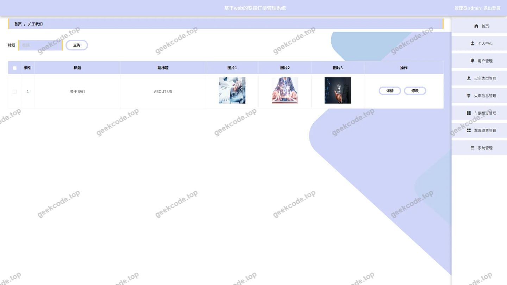</a>

<h4>后台-火车类型</h4>

<a href="https://geekcode.top/archives/%E5%9F%BA%E4%BA%8Eweb%E7%9A%84%E9%93%81%E8%B7%AF%E8%AE%A2%E7%A5%A8%E7%AE%A1%E7%90%86%E7%B3%BB%E7%BB%9F-%E8%AE%BA%E6%96%87?utm_source=github" title="查看完整源码">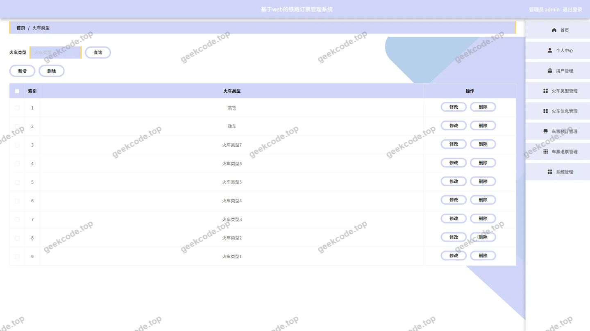</a>

<h4>后台首页</h4>

<a href="https://geekcode.top/archives/%E5%9F%BA%E4%BA%8Eweb%E7%9A%84%E9%93%81%E8%B7%AF%E8%AE%A2%E7%A5%A8%E7%AE%A1%E7%90%86%E7%B3%BB%E7%BB%9F-%E8%AE%BA%E6%96%87?utm_source=github" title="查看完整源码">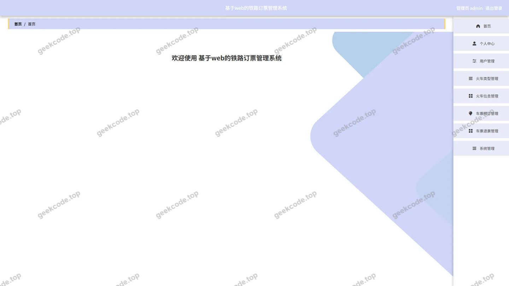</a>

<h4>后台-系统简介</h4>

<a href="https://geekcode.top/archives/%E5%9F%BA%E4%BA%8Eweb%E7%9A%84%E9%93%81%E8%B7%AF%E8%AE%A2%E7%A5%A8%E7%AE%A1%E7%90%86%E7%B3%BB%E7%BB%9F-%E8%AE%BA%E6%96%87?utm_source=github" title="查看完整源码">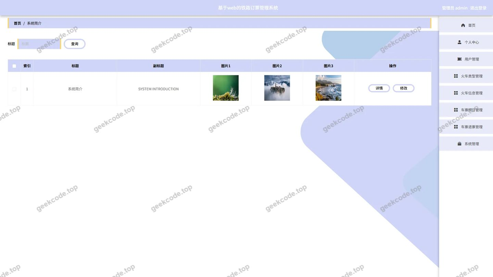</a>

---

## 获取完整源码

| 项目 | 说明 |
| --- | --- |
| 项目名 | 基于web的铁路订票管理系统--论文 |
| 运行截图 | 本文 15 张（站点带水印原图，仓库 `images/` 目录） |
| 完整源码 | [https://geekcode.top/archives/%E5%9F%BA%E4%BA%8Eweb%E7%9A%84%E9%93%81%E8%B7%AF%E8%AE%A2%E7%A5%A8%E7%AE%A1%E7%90%86%E7%B3%BB%E7%BB%9F-%E8%AE%BA%E6%96%87?utm_source=github](https://geekcode.top/archives/%E5%9F%BA%E4%BA%8Eweb%E7%9A%84%E9%93%81%E8%B7%AF%E8%AE%A2%E7%A5%A8%E7%AE%A1%E7%90%86%E7%B3%BB%E7%BB%9F-%E8%AE%BA%E6%96%87?utm_source=github) |
| 咨询微信 | **ir9372**（备注：jingpin-yuanma） |
| 更多项目 | [极客代码 geekcode.top](https://geekcode.top/?utm_source=github) |

> 需要源码、部署、改配置、跑不起来等问题，加微信 ir9372 沟通，说明项目名即可。
